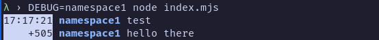
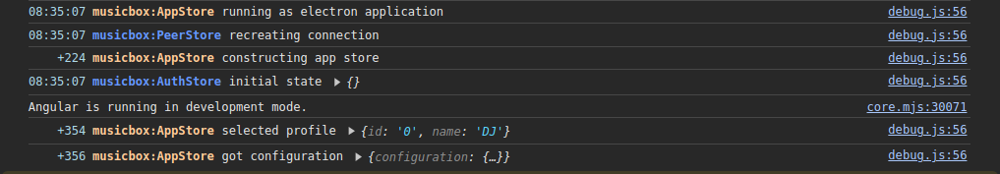

# @microphi/debug [](https://www.npmjs.com/package/@microphi/debug)

> Namespaced `console.log` wrapper, filtered by the `DEBUG` env var

## Install

```sh
npm i @microphi/debug
```

## How to use

```typescript
import { getDebugger } from '@microphi/debug';

const d = getDebugger('musicbox:player');

d('loading', { track: 42 });
```

Each namespace gets its own colour, and lines are prefixed with the time, or with the ms since the previous line when they come less than a second apart.

### Node.js

Set `DEBUG` to a comma-separated list of regexes; a namespace that matches any of them is logged.

```sh
DEBUG=musicbox:.*,db node app.js
```



### Browser

Same, through `localStorage.debug`:

```js
localStorage.debug = 'musicbox:.*';
```



### Other runtimes

Without `process` or `localStorage`, e.g. on Cloudflare Workers without the `nodejs_compat` flag, every namespace is off. With `nodejs_compat`, `DEBUG` is read from `process.env` as in Node; Workers fill `process.env` from the vars only from compatibility date 2025-04-01 (or with the `nodejs_compat_populate_process_env` flag).

## `onMessage`

Registers a callback that receives every message, matching or not, as long as `DEBUG` is set. Handy to ship logs to a server or a file.

```typescript
import { onMessage } from '@microphi/debug';

onMessage(({ formattedTime, namespace, args }) => {
  // ...
});
```

## Console to file

Node only: importing this entry point redirects every `console.log` to a file.

```typescript
import '@microphi/debug/console-to-file';

console.log('this goes to the file');
```

The path comes from `CONSOLE_LOG_FILE` (default `./console.log`). If a write fails, it falls back to the original `console.log`.
